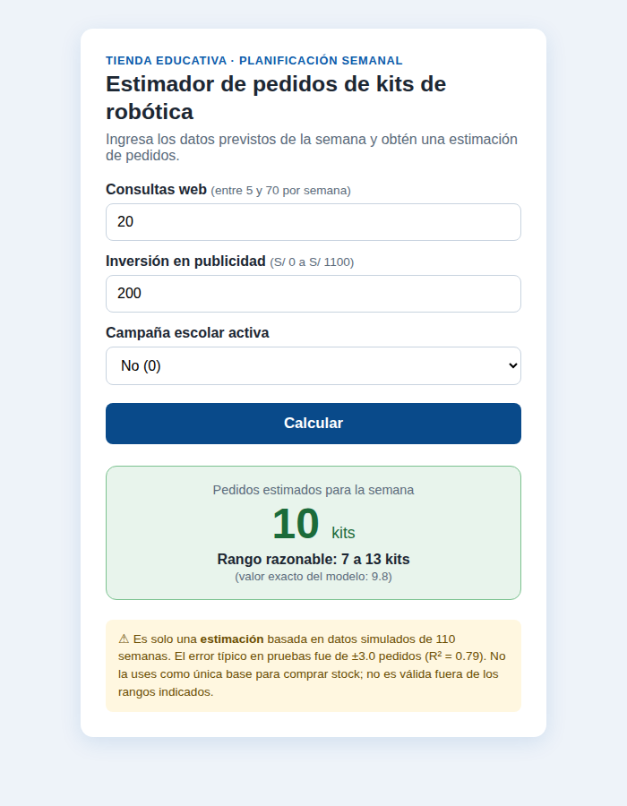
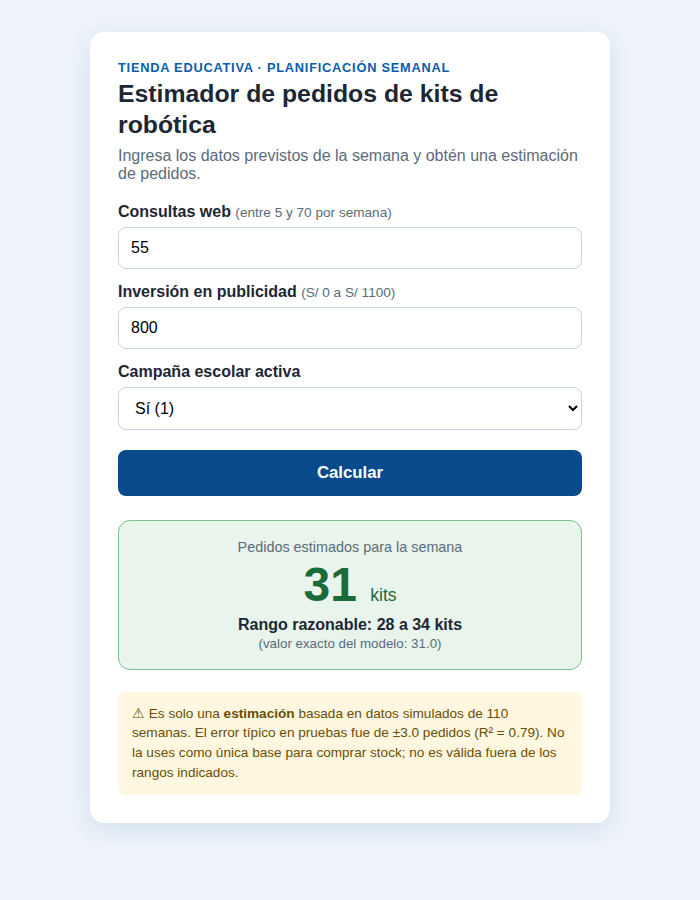

# 🤖 Estimador de pedidos de kits de robótica

Aplicación web en **Flask + HTML + CSS** (sin JavaScript) que estima los pedidos semanales de kits de robótica a partir de las consultas web, la inversión en publicidad y si hay campaña escolar.
Proyecto del taller de Machine Learning y Deep Learning — SENATI (Caso 01).

🔗 **Demo:** _pega aquí tu enlace_

## Modelo
Regresión lineal múltiple (scikit-learn) entrenada con 110 semanas **simuladas** (80 % entrenamiento / 20 % prueba, `random_state=42`):

```
pedidos ≈ 1.54 + 0.346·consultas_web + 0.0067·inversion_publicidad_soles + 5.02·campana_escolar
```

| Métrica (prueba) | Valor |
|---|---|
| MAE | ≈ 2.95 pedidos |
| R² | ≈ 0.79 |

Los coeficientes están en `modelo.json`, por lo que la web **no necesita scikit-learn**.

## Ejecutar en local
```bash
pip install -r requirements.txt
python app.py
```
Abrir http://127.0.0.1:5000

## Estructura del repositorio
```
├── app.py              # lógica de Flask: validar, predecir y ruta
├── modelo.json         # coeficientes, rangos y métricas del modelo
├── templates/
│   └── index.html      # página (HTML)
├── static/
│   └── estilos.css     # estilos (CSS)
├── capturas/           # capturas de las pruebas
├── requirements.txt    # librerías (flask, gunicorn)
├── Procfile            # arranque en Render
└── README.md
```

## Pruebas
| Entrada | Resultado |
|---|---|
| 20 consultas · S/ 200 · sin campaña | ≈ 10 pedidos (9.8) |
| 55 consultas · S/ 800 · con campaña | ≈ 31 pedidos |




## Validación y límites
- Rangos válidos: consultas 5–70, publicidad S/ 0–1100, campaña 0 o 1. La validación se hace en el servidor.
- Es una **estimación**, no una cifra exacta (error típico ±3 pedidos).
- Datos simulados; no incluye precio, competencia, feriados ni stock.
- Los coeficientes describen asociaciones, no causas.

## Publicar gratis
**Render:** New → Web Service → conectar este repositorio · Build: `pip install -r requirements.txt` · Start: `gunicorn app:app`.
**PythonAnywhere:** subir los archivos, crear una web app Flask y en el WSGI poner `from app import app as application`.
